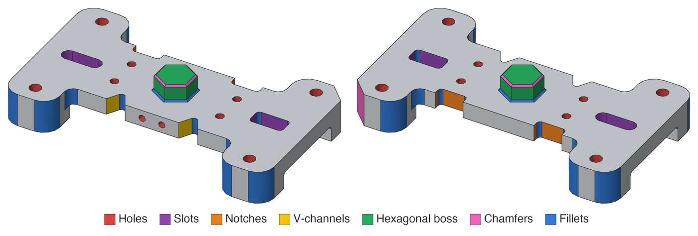

# quiddity

quiddity reads a STEP model and finds its manufacturing features (holes, pockets, slots, bosses,
steps, fillets, chamfers, patterns, springs and turned profiles) with their measured sizes and
positions. It reads and writes AP242 PMI (dimensions, tolerances, datums, notes and their callouts),
and matches features between two revisions of a part. It works from the B-rep geometry alone, with no
CAD system, feature tree or OpenCascade: pure Rust, the same output for the same input, on Windows,
macOS, Linux and in the browser, as a Python package, a command line or a Rust library.


*Features recognised by quiddity on eight public parts. Colours and counts are quiddity's own
output. Parts: NIST MBE PMI test cases; FreeCAD library parts by Rbgo Web, Francisco and
hasecilu ([CC BY 3.0](https://creativecommons.org/licenses/by/3.0), renders adapted); text-to-cad
(© Thompson Labs LLC, MIT); build123d / Gumyr / Too Tall Toby (Apache-2.0). Rendered with
draftwright-editor's `npm run showcase:render`.*

**Contents:** [Results](#results) · [Install](#install) · [Command line](#command-line) ·
[Output](#output) · [Read and write PMI](#read-and-write-pmi) · [Compare two revisions](#compare-two-revisions) ·
[Python and Rust](#python-and-rust) · [Limits](#limits) · [Packages](#packages) ·
[How it's built](#how-its-built) · [Contributing](#contributing) · [History](#history)

Status: **0.5.1** (2026-11-13). See [CHANGELOG.md](CHANGELOG.md).

## Results

Measured with 0.5.1; full report, commands and raw data in
[docs/benchmarks/v0.5.1-measurements.md](docs/benchmarks/v0.5.1-measurements.md).

**Feature recognition** on all 9,375 models of the public [MFInstSeg](https://github.com/whjdark/AAGNet)
test split (no failures). Recall: share of labelled features found. FP: share of reported features
that match nothing labelled.

| Feature | Recall | FP |
|---|---:|---:|
| Holes | 96% | 11% |
| Fillets | 87% | 6% |
| Pockets | 85% | 23% |
| O-ring grooves | 85% | 0% |
| Passages | 74% | 11% |
| Steps | 71% | 10% |
| Slots | 63% | 17% |
| Chamfers | 54% | 26% |
| **All features** | **77%** | **14%** |

- **Robust:** a fixed 10% sample of all 62,495 MFInstSeg models runs with no read or recognition
  failures and no crashes.
- **Accurate geometry:** volume, area and centre of mass agree with the values stored in NIST STEP
  files (103 of 106 checks within 0.1%) and with OpenCascade (9,110 of 9,120 checks), using the
  [geometric validation tool](docs/geometric-validation.md).
- **Fast:** a median 13 ms to read a part and 73 ms to recognise it.
- **From Python:** 10.7× faster than the last pure-Python quiddity (0.3.12), in 32 MB of memory
  instead of 418 MB, installed as one 25 MB package instead of 59 packages and 876 MB.

## Install

| You use | Install | Platforms (tested in CI) |
|---|---|---|
| **Python 3.11+** | `pip install quiddity`: one wheel, no other dependencies ([Python guide](docs/python.md)) | Windows x64, macOS arm64 and x86_64, Linux x86_64 and aarch64 |
| **Command line** | `uv tool install quiddity` or `pipx install quiddity` (no Rust needed), or `cargo install quiddity` | the same five |
| **Rust** | `quiddity = "0.5"` in `[dependencies]` ([crates and features](docs/rust.md)) | Linux, macOS |
| **Browser** | the library builds for WebAssembly (`wasm32-unknown-unknown`, see [WebAssembly](docs/rust.md#webassembly)); [draftwright's editor](https://draftwright.io) runs it | built on Linux in CI |

Every [release](https://github.com/pzfreo/quiddity/releases) is published to PyPI and crates.io.

## Command line

```sh
quiddity part.step                      # the part's features, as JSON
quiddity correspond old.step new.step   # what changed between two revisions
quiddity pmi read part.step             # the file's PMI, as JSON
```

STEP inputs may be `.step`, `.stp` or gzipped. Commands print JSON; the exit code is 0 for success,
1 for an unreadable file or a refused operation, and 2 for wrong usage. Every command, the
`serve` mode for applications and shell completion: [docs/cli.md](docs/cli.md).

Read large assemblies one product at a time with `quiddity manifest` and
`quiddity recognise --manifest`; see [assembly manifests](docs/assemblies.md)
for range checks, placements, fallback and Python APIs.

## Output



*Each face of NIST CTC-01 (AP242) coloured by the feature it belongs to; grey faces belong
to no feature shown here.*

For a part with a counterbored hole, `quiddity part.step` includes:

```json
{
  "id": "holes/0",
  "family": "holes",
  "faces": [6, 8],
  "parameters": {
    "diameter": 8.0, "depth": 14.0, "bottom": "through",
    "cbore": { "diameter": 16.0, "depth": 6.0 },
    "axis": [0.0, 0.0, -1.0], "location": [-22.0, 0.0, 10.0]
  },
  "evidence_status": "verified"
}
```

That record is one entry of the output's `document`, the versioned form to build on
(`quiddity-rust/recognition/6`; the identifier keeps its original name):

- **`records`**: one entry per feature. Each gives its family, the STEP faces it is made of,
  its measured parameters, and whether its evidence is `verified` or `unproved`.
- **`face_accounting`**: what every face of the part is: part of a feature, part of the body
  (with the reason), or refused or unexplained.
- **`source_sha256`**: the input file's hash.

Every coordinate and direction is in the file's own coordinates. quiddity finds the part's
natural orientation itself, so a part rotated in its file is recognised the same way.

What each field means: [schema 6](docs/recognition-6.md), [face accounting](docs/face-accounting.md),
and [the trust contract](docs/recognition-trust.md), which says what `verified` does and
doesn't promise.

### Families

| Kind | Families |
|---|---|
| Holes | `holes` (through, blind, counterbored, countersunk, spotfaced), `countersinks`, `hole_patterns`, `double_d_bores`, `modelled_threads` |
| Pockets and slots | `pockets`, `prismatic_pockets`, `edge_open_circular_pockets`, `edge_open_prismatic_recesses`, `pocket_patterns`, `slots`, `rectangular_blind_slots`, `round_bottom_blind_slots`, `semicircular_blind_slots`, `slot_patterns`, `rectangular_through_notches` |
| Channels and grooves | `channels`, `v_channels`, `grooves`, `annular_grooves`, `face_grooves` |
| Steps and levels | `through_steps`, `angled_steps`, `oblique_through_steps`, `paired_ramp_steps`, `circular_blind_steps`, `step_levels`, `risers` |
| Raised features | `bosses`, `polygonal_bosses`, `pads`, `gusset_ribs`, `gusset_rib_patterns` |
| Edges | `fillets`, `blends`, `chamfers` |
| Turned parts | `turned_bodies`, `turned_steps`, `repeating_radial_profiles`, `circular_face_patterns` |
| Springs | `helical_springs` |
| Body | `plates`, `polygonal_stock`, `sheet_metal_bodies`, `thin_wall_bodies`, `flats`, `interior_voids`, `cylindrical_profiles`, `freeform_surfaces` |
| Sections | `section_passages`, `section_recesses` |

## Read and write PMI

quiddity reads semantic AP242 PMI and writes it back into the same file. PMI JSON is bound
to the exact STEP text it was read from; a write keeps everything else in the file, and
checks the result by reading it back before replacing the destination.

- **Modes:** `replace` re-authors the part's PMI; `add` adds to it and keeps every existing
  entity byte for byte (it refuses, naming the entities, if that isn't possible); `remove`
  takes PMI out.
- **Callouts:** the writer draws the visible callouts (frames, dimensions, datums, notes)
  in tessellated strokes. It lays them out itself, or uses the positions a source supplies
  (`--source-presentation`, Python `presentation=`), drawing only what the source didn't place.
- **Practice:** the writer follows the CAx-IF PMI Recommended Practice, and the reader
  reports where a file departs from it. See [AP242 practice](docs/step-ap242.md).

```sh
quiddity pmi read part.step [--part N] > part.pmi.json
quiddity pmi check part.step part.pmi.json
quiddity pmi write part.step part.pmi.json -o out.step [--mode add|replace|remove]
```

With `--features json-import`, the versioned interchange ([reference](docs/pmi-json.md)) is
also available, for producers such as XCAF converters:

```sh
quiddity pmi json export part.step > part.pmi.json
quiddity pmi json validate part.pmi.json
quiddity pmi json import part.step part.pmi.json -o written.step [--source-presentation callouts.json]
quiddity pmi json presentation part.step > part.presentation.json
```

The schemas ship in haecceity's `schema/` directory. From Python, `quiddity.pmi` does the
same in process (`pmi.validate`, `pmi.write`); see [Python](docs/python.md).

## Compare two revisions

`quiddity correspond old.step new.step` says what happened to each feature between two
revisions: `carried` (unchanged), `adapted` (with what changed), `orphaned` (gone in the
new revision) or `ambiguous` (more than one candidate, so none is guessed), and which
features are new. It works when the part is moved or re-modelled, because it matches
revision-independent fingerprints rather than face numbers. If a hole moves:

```json
{ "old": "holes/2", "new": "holes/2", "class": "adapted",
  "changes": { "position": { "old": [40.0, 45.0, 5.0], "new": [25.0, 45.0, 5.0] } } }
```

Either side can also be saved recognition JSON. In Rust, use
`quiddity::correspond(&old.fingerprints, &new.fingerprints)`. See [correspondence](docs/correspondence.md).

## Python and Rust

```python
import json, quiddity

document = json.loads(quiddity.recognise("part.step"))["document"]
for feature in document["records"]:
    print(feature["family"], feature["parameters"], feature["faces"])
```

When both complete recognition and face evidence are needed,
[`recognise_with_evidence`](docs/shared-analysis.md) shares their analysis while
preserving each document's categories, coordinates and error semantics.

```rust
let part = quiddity::read_step_file(std::path::Path::new("part.step"))?;
let recognised = quiddity::correspondence::recognise(&part);
let document = quiddity::recognition::document(&recognised, part.faces.len());

for record in document.records.iter().filter(|r| r.family == "holes") {
    let p = &record.parameters;
    println!("{}: Ø{} × {} on faces {:?}", record.id, p["diameter"], p["depth"], record.faces);
}
```

## Limits

- quiddity reports what it can prove from the geometry. A file that reads without errors
  isn't a promise that every feature was found: check `face_accounting` for faces left
  unexplained.
- Malformed solids, approximate boundaries and unsupported surfaces can give refusals or
  `unproved` records. Refusals are records too, so nothing is silently dropped.
- Known wrong results are listed, with evidence, in [known defects](docs/known-defects.md).
- How the STEP reader heals input to match OpenCascade: [notes](docs/opencascade.md).

## Packages

| Package | What it is |
|---|---|
| `quiddity` (crate) | recognition, fingerprints, correspondence, the PMI JSON and the command line |
| `haecceity` (crate, `crates/haecceity`) | the geometry: STEP reading, the B-rep, measurement and queries, and semantic PMI reading and writing (it does not model; see its README); re-exported as `quiddity::kernel` |
| `quiddity` (Python, `crates/quiddity-py`) | the Python wheel over both |

## How it's built

quiddity is written with AI coding agents (Anthropic's Claude and OpenAI's Codex), directed and
reviewed by its maintainer. Each change starts from a written brief and must pass CI; large
changes also get an independent review before they merge. The checks are what make its claims trustworthy, not who typed
the code:
- 1,406 tests and 2,703 regression snapshots;
- the measurements above, against public datasets, with their commands and raw data committed;
- one rule throughout: tests are never loosened to make a change pass, and recognition refuses a
  feature rather than guess it.

## Contributing

See [CONTRIBUTING.md](CONTRIBUTING.md), and [docs/development.md](docs/development.md) for
how the test suite and regression snapshots work. Contributions are taken under
[Apache-2.0](LICENSE), with each commit signed off (`git commit -s`) under the
[Developer Certificate of Origin](CONTRIBUTING.md#developer-certificate-of-origin).

## History

This repository was called quiddity-rust until 2026-11-03; identifiers such as
`quiddity-rust/recognition/6` keep that name. It began as a port of the Python quiddity
library (now [pzfreo/quiddity-python](https://github.com/pzfreo/quiddity-python)), which it no
longer depends on; the archived comparison is in [docs/history](docs/history/python-parity.md).
